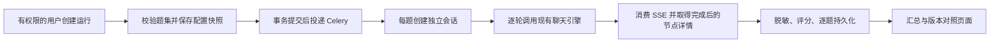

# 任务 1：评测基线与版本对照设计草案

日期：2026-10-09。状态：用户已指示以“Agent 评测与效果迭代”为重点推进；进入实施计划阶段，尚未实现。

优先级：先建立可信的题集、判分和失败归因，再实现支撑它们的批量运行与报告。后端基础设施服务于评测，不扩大为通用评测平台；本阶段不实现任务 2—6 的优化策略。

## 目标与边界

按 `docs/IMPLEMENTATION_TASKS.md` 完成任务 1，为任务 2—6 提供同题集、可追溯的对照能力。交付包含 20 题开发集、80 题冻结集、批量服务、管理 API、报告页面、行为测试和真实模型基线记录。

基线明确标记为上游 `4aad53c4316f956ecef69e1dc5d3ab3a1e80080b` 加任务 0 的本地模型兼容性补丁。保留当前工作区已有改动与任务 0 证据。评测功能不改变原有问答、检索、工具或选模逻辑。

## 方案选择

1. **推荐：Django 内的评测模块 + Celery 批量任务 + 应用详情报告页。** 复用现有认证、权限、数据库和运行引擎，满足持久化与管理页面要求；需要新增模型迁移及前后端接口。
2. 独立命令行脚本通过 HTTP 调用聊天接口：适合早期探测，但还要另建权限、进度与页面，不能单独满足验收。
3. 外部评测平台：增加部署与数据同步成本，当前任务没有必要。

推荐方案中，评测代码放在 `apps/application/` 的独立模块，复用该应用的模型发现、迁移和 URL 注册机制；避免为一次增量引入新平台。

## 已核对的接入点

- `apps/application/urls.py` 提供管理端应用 open、chat_message 和聊天记录接口。
- `apps/chat/serializers/chat.py` 的 `ChatSerializers` 执行问答与工作流；`DebugChatSerializers` 会重新读取当前应用，因此不能直接把可变草稿当作固定运行版本。
- `apps/common/handle/impl/response/system_to_response.py` 定义 SSE 内容、节点 ID、结束标记和 usage。
- `apps/application/models/application_chat.py` 的 `ChatRecord` 保存答案、details、token 与耗时。token 默认值为 0，本身不证明供应商确实返回了用量。
- `apps/application/views/application.py` 使用 `has_permissions` 和应用资源权限；新 API 应复用该规则，并额外核对 workspace、application 与 run 的归属。
- `ui/src/router/modules/application-detail.ts` 是应用详情页面路由入口。

## 数据流与执行隔离

- 每次创建生成新的 UUID run_id，不覆盖历史结果。多轮题共享题内会话，不与其他题共享历史。
- 首版每批串行执行，便于控制模型并发和复现时序；每题记录独立状态与异常，失败后继续下一题。
- 创建时固定应用/工作流内容、模型非敏感配置、提示词、参数、知识库证据映射及哈希。运行使用固定内容；无法冻结的依赖在开始前及题间核验，变更时终止该批并记录配置漂移，不能继续混入新版本。
- Celery 只接收 run_id。使用原子状态领取防止重复消息重复执行；执行中断标为 interrupted，不自动重放可能已经调用模型或工具的题目。重新运行创建新 run_id。
- 首版只执行公开资料题和受控只读工具。超时场景由专用夹具注入，不调用有副作用的生产工具。

## 持久化结构

运行记录：run_id、workspace_id、application_id、创建人、状态、开始/结束时间、进度、代码 SHA、本地差异哈希、运行镜像标识、数据集版本及 SHA256、应用/工作流与模型配置快照、知识资料哈希、评分规则版本、汇总和错误。

逐题记录：run_id + case_id 唯一、场景、输入轮次、实际 chat/record ID、每轮答案、检索证据、引用、脱敏节点轨迹、输入/输出 token、用量来源与状态、费用与来源、耗时、错误、规则检查结果、人工评分和复核人/时间。保存后不依赖聊天历史永久存在。

模型快照仅包含允许公开的 ID、供应商、模型名、参数与可追溯版本；供应商未返回固定版本时标明“版本未固定”，不能把可漂移的名称当成不可变版本。密钥、认证头、工具凭据和任意原始工具配置不进入快照、API、日志或导出。

## 题集与判分

版本化 JSON 文件包含 case_id、split、scenario、turns、公开资料来源及内容哈希、required_evidence_ids、expected_facts、acceptable_answers、tool_expectation、rubric。题集以逻辑证据 ID 标注，导入知识库后保存到实际文档/段落 ID 的映射。

20 题开发集和 80 题冻结集覆盖简单直答、多段证据、重复段落、无相关资料、长对话指代、工具成功、工具超时、资料冲突和模型路由。路由题在原版基线中记录固定模型行为，不要求任务 1 提前实现任务 6。长对话与工具异常也保留原版失败作为对照。

两套题独立编写，避免仅替换措辞。冻结前完成事实、证据与判分规则审核；冻结后保存版本和哈希，不依据运行结果调参或修改答案。任务 0 的单段资料不足以覆盖这些场景，需要扩充公开资料快照和受控测试资料；自编夹具明确标记，不伪称外部事实。

确定性规则只生成规则检查结果；语义正确性和引用是否真正支持答案由人工复核。人工结果必须记录复核人、规则与时间，未复核显示 pending，不能把模型自评分或关键词命中直接算成人工正确率。

## 指标口径

- 正确率：已复核正确题 / 全部题，同时展示复核覆盖率；未完成复核时不标为最终正确率。
- 证据召回率：所需证据中被检索到的比例；按有证据要求的题计算并展示分母。
- 引用准确率：人工确认支持对应主张的引用 / 已复核引用；无引用题不伪记 100%。
- 工具任务完成率：满足预定义工具行为与输出断言的题 / 工具题数。
- 平均输入/输出 token：仅对可确认计量的题统计，同时显示计量覆盖率；多轮和多模型均求和，任一缺失则整题合计未知。
- 实际费用：使用供应商可核对费用/账单数据；价目乘 token 只能标为估算，并记录价目来源、币种和生效日期。无可靠来源时为 null，界面显示“未知”。
- 每成功任务费用：整个批次费用（包含失败消耗）/ 成功题数；费用不全或成功数为零时未知，不混合不同币种。
- P95：按每题端到端耗时采用 nearest-rank（排序后 ceil(0.95*N)），展示样本数，失败与超时纳入并保留原因。
- 不把 SSE 各帧的累计 usage 重复求和。只有确认完整、可靠的结束用量才进入统计；上游默认零与缺失计量须区分，明确未调用模型的工具题可以记录零。

## API、权限与页面

管理端路径置于 `workspace/{workspace_id}/application/{application_id}/evaluation` 下，提供创建运行、运行列表/进度、运行详情、逐题详情、人工评分及两个已结束运行的对照。

创建运行与评分要求相应应用编辑权限；读取遵循应用读取权限。所有查询按 workspace/application 过滤，比较时分别验证两个 run 的权限。无权限用户不能通过 run_id、case_id 或比较接口跨应用读取结果。前端权限仅控制入口，后端独立检查。

应用详情增加“评测”页：选择版本化题集并创建运行，显示进度；选择两个运行后展示配置差异、各汇总指标、计量/人工复核覆盖率、逐题答案与指标差异，展开失败轨迹。数据集哈希或关键配置不一致时明确标记不可作为严格对照，不暗示提升来自代码变更。

## 实施检查点与验收

1. 题集 schema、计量/SSE/评分纯函数：先写失败测试，再实现；检查 20/80 数量、唯一 ID、证据映射和冻结哈希。
2. 数据模型与批量执行：覆盖成功、单题失败继续、重复运行不覆盖、多轮隔离、任务重复投递、配置漂移与中断。
3. 管理 API：覆盖未登录、无权限、跨工作空间、跨应用、比较一侧越权、快照与异常脱敏。
4. 报告页面：验证未知值、失败轨迹、人工评分和逐题对照；运行前端类型检查、构建及针对改动文件的只读 lint，避免全仓自动改写。
5. 在已验收基线上执行两次开发集，保存原始结果和随机性差异；核对配置后仅执行一次冻结集基线。服务接入测试使用受控夹具，真实模型基线单独记录。
6. 记录所有测试命令、退出码、截图/结果文件与限制。不以任务 0 检查代替本次检查，不把实现完成等同于人工评分完成。

真实批量执行前需要确认可用 API 额度/费用预算；当前材料只证明两模型已可调用，没有给出任务 1 批量费用上限。此项不阻碍本地实现和无费用测试。费用来源无法取得时如实显示未知，保留其为验收限制；人工复核未完成时不能宣称最终基线评分已验收。
